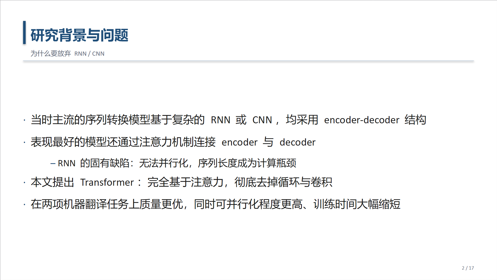
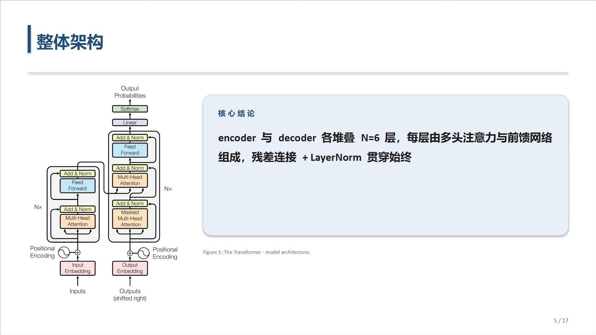
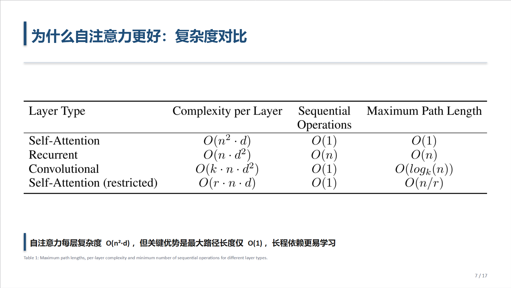

# dsh-group-meeting-slides

[English](#english) · [中文](#中文)

把一篇英文论文 PDF 变成**中文组会汇报 PPT**的 DeepSeek Harness 技能。
论文里的每张图、每个表都用**原文自己的像素**，不重画、不臆造数字。

> An agent skill for [DeepSeek Harness](https://github.com/deepseek-ai) that turns an
> English paper PDF into a Chinese group-meeting (组会 / 文献汇报) slide deck.
> Every figure and table keeps the paper's own pixels — nothing is redrawn, no
> number is invented.

---

## 效果

| 封面 | 正文 |
|---|---|
|  |  |

| 图（原图 + 英文 caption） | 表（带结论条） |
|---|---|
|  |  |

以上四页由本技能从 *Attention Is All You Need*（Vaswani et al., NeurIPS 2017）
直接生成，未做手工修图。

## 安装

技能就是 `~/.dsh/skills/` 下的一个文件夹，拷进去即可被发现：

```powershell
# Windows
git clone https://github.com/wld12314/dsh-group-meeting-slides.git
Copy-Item -Recurse dsh-group-meeting-slides\group-meeting-slides "$env:USERPROFILE\.dsh\skills\"
```

```bash
# macOS / Linux
git clone https://github.com/wld12314/dsh-group-meeting-slides.git
cp -r dsh-group-meeting-slides/group-meeting-slides ~/.dsh/skills/
```

重启 DSH（或新开一个会话）后，对 agent 说「把这篇论文做成组会 PPT」并给出 PDF 路径即可。

## 依赖

脚本需要 Python 与三个库，由 agent 通过 `load_workspace_dependencies`
取到解释器后调用，你不必手动装到系统 Python 里：

| 库 | 用途 |
|---|---|
| `PyMuPDF` | 解析 PDF 版面、按真实 bbox 裁剪图片 |
| `python-pptx` | 生成 `.pptx` |
| `Pillow` | 图片尺寸与宽高比处理 |

若 agent 报告缺少这些库，把上面的列表发它，让它装到工作区依赖里。

## 它怎么工作

技能刻意把**机械活**和**判断活**分开：

| 谁 | 干什么 |
|---|---|
| `scripts/extract.py` | PDF 几何、图注定位、按 bbox 抠图、整页渲染兜底 |
| `scripts/build_pptx.py` | 版式、字体、图片等比放置（13.333×7.5 宽屏，academic / dark 双主题） |
| Agent | 读论文、定叙事、写中文文案、逐张核对图片 |

```
extract.py  →  paper.md + figures.json + figures/ + tables/ + pages/
                       ↓
              agent 逐张看图、读论文、写 deck.json
                       ↓
build_pptx.py  →  <课题>_组会汇报.pptx  +  讲稿.md
```

### 关键设计：先看图，再写字

`SKILL.md` 里有一条硬性流程：**写任何一页之前，必须先把 `figures/` 和
`tables/` 里每张图打开看一遍**，并且做语义核对——图注说的是 Table 2，
图里真的是 Table 2 吗？两个 crop 是否字节相同（说明两个图注指到了同一个
对象，至少一个是错的）？

裁剪是几何启发式，它一定会出错。这一步是唯一能抓住「框得很漂亮但框错了表」
的地方。

## 目录结构

```
dsh-group-meeting-slides/
├── README.md
├── LICENSE
├── assets/preview/                 # README 预览图
└── group-meeting-slides/           # ← 整个文件夹拷进 ~/.dsh/skills/
    ├── SKILL.md                    # 触发词、工作流、硬规则
    ├── references/
    │   ├── deck-schema.md          # deck.json 的完整契约
    │   └── storyline.md            # 12–18 页的组会叙事与中文写作规范
    └── scripts/
        ├── extract.py
        └── build_pptx.py
```

## 硬规则

这些不是建议，是技能运行时强制执行的：

- **绝不臆造数字**。幻灯片里出现的每个数都要能追到论文正文或某张已裁的表。
- **绝不用 python-pptx 重画图表**。宁可少一页，也不给一张错的图。
- **保持宽高比**。`build_pptx.py` 强制，不允许绕过它直接 `add_picture`。
- **每张图下方保留英文原图注**，方便听众回原文核对。
- 文案用中文，术语首次出现保留英文，例如
  「缩放点积注意力（scaled dot-product attention）」。

## 兼容性

| 宿主 | 状态 |
|---|---|
| DeepSeek Harness 桌面版 | 已验证 |
| DeepSeek Harness Web 版 | 应当可用——技能层由宿主统一加载，不依赖桌面独有 API |

技能是纯 Markdown + Python，不引入任何 npm 包，也不依赖 Cordis 插件 API。

## 许可

[Apache-2.0](LICENSE) © 2026 海龟饲料 ([@wld12314](https://github.com/wld12314))

---

## English

An agent skill for DeepSeek Harness. Give it an English paper PDF; it produces a
Chinese group-meeting `.pptx` plus speaker notes, where every figure and table is
the paper's own pixels cropped at the real bounding box — never redrawn, never
estimated.

**Install:** copy `group-meeting-slides/` into `~/.dsh/skills/`.

**Requires:** Python with PyMuPDF, python-pptx, Pillow (resolved by the host's
`load_workspace_dependencies`, not your system Python).

**Why it is split this way:** the scripts own everything mechanical and
reproducible — PDF geometry, figure cropping, typography, aspect-ratio-safe
placement. The agent owns what needs judgement — reading the paper, deciding the
argument, writing the copy. Before writing a single slide the agent must open and
semantically verify every extracted image, because geometric cropping fails in
ways geometry cannot detect.

Licensed under Apache-2.0.
